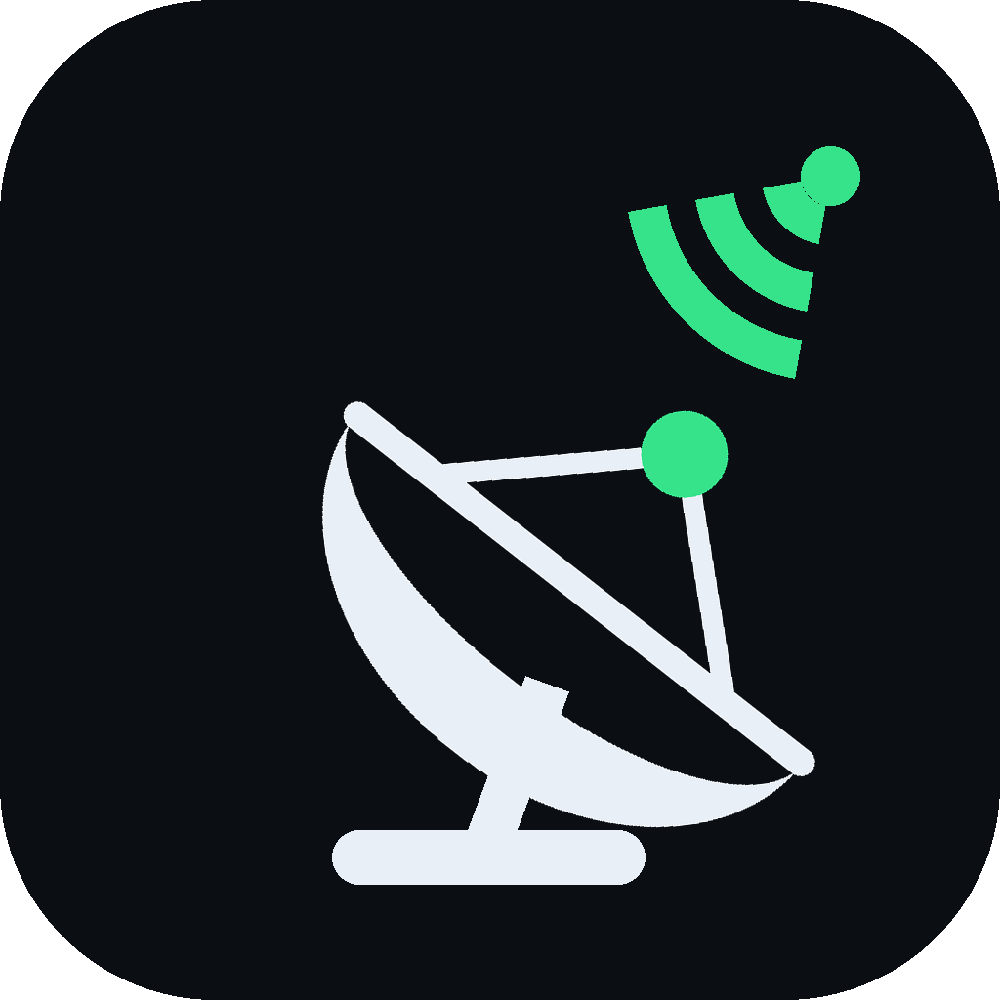
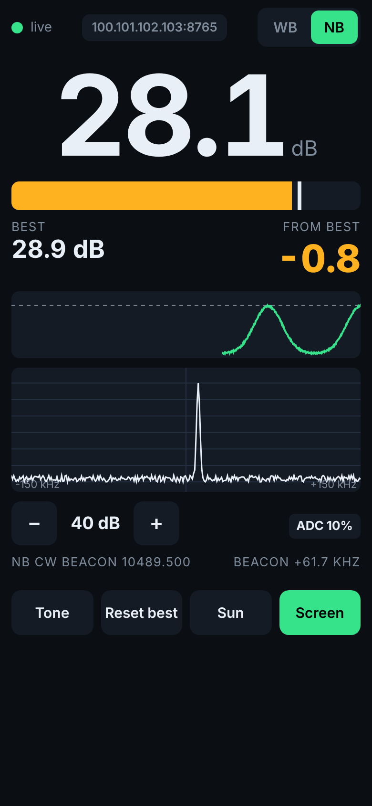
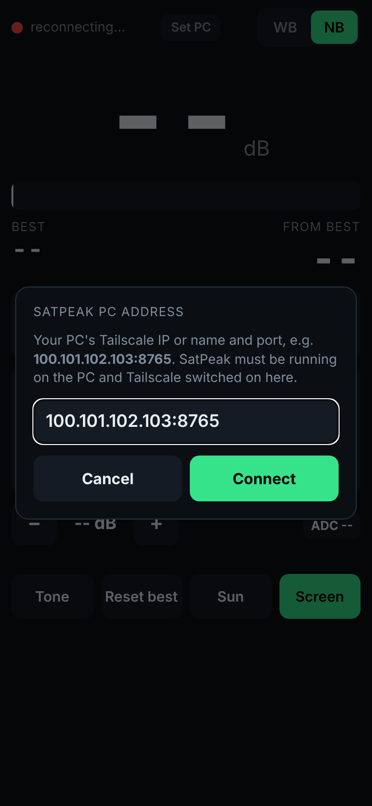

<p align="center"></p>

<h1 align="center">SatPeak</h1>
<p align="center"><b>Real-time QO-100 dish peaking meter: PlutoSDR on your PC, live reading on your phone.</b></p>

<p align="center">

&nbsp;&nbsp;

</p>

SatPeak measures the signal-to-noise ratio of a QO-100 (Es'hail-2) beacon with an ADALM-Pluto and streams it to your phone about 25 times a second over [Tailscale](https://tailscale.com). You can stand at the dish and peak azimuth, elevation and LNB skew by watching the number or listening to a tone.

```
Dish + LNB ──coax──▶ PlutoSDR ──USB──▶ PC: SatPeak.exe ──Tailscale (WebSocket)──▶ phone app / browser
```

## Features

- **Two beacons:** NB CW beacon (10489.500 MHz, default) for precise peaking, and the WB DVB-S2 beacon (10491.500 MHz) for coarse finding.
- **Low latency:** about 25 updates/s with a few tens of ms end-to-end. The server sends only the latest reading, so a slow link never builds a backlog.
- **Peak-hold "From best" readout:** green within 0.5 dB of your best reading. Also shows 30 s of history, a spectrum view, and an audio tone whose pitch rises with signal.
- **Automatic LNB offset:** finds and displays the CW beacon within ±150 kHz of nominal.
- **Manual gain** (AGC would flatten the peak) with an ADC clipping warning.
- **Windows installer:** bundles Python and the libiio driver, with no admin rights needed. Finds the Pluto on USB or the network automatically.
- **Android app:** keeps the screen on and remembers the PC address. Any other device can use a web browser.
- **Demo mode** with a simulated signal, for testing the phone link indoors.

## Quick start

1. Download **SatPeak-Setup-1.0.0.exe** and **SatPeak.apk** from [Releases](../../releases).
2. **PC:** run the installer and start SatPeak. Allow it through Windows Firewall when asked, and note the address it shows, e.g. `100.101.102.103:8765`.
3. **Phone:** install the APK, turn Tailscale on, open SatPeak and enter that address. On an iPhone, open `http://<address>` in the browser instead.
4. Peak the dish. The full illustrated guide is in [docs/SatPeak-HowTo.pdf](docs/SatPeak-HowTo.pdf).

> The LNB needs external power (bias-tee). Only one program can use the Pluto at a time, so close SDR Console, SATSAGEN and similar programs first.

## Running from source

```bash
cd server
pip install -r requirements.txt          # needs the libiio C library installed
python qo100_peaker.py                   # real Pluto, auto-detected
python qo100_peaker.py --demo            # simulated signal
python selftest.py                       # starts a demo server and checks the stream
```

| Option | Default | Meaning |
|---|---|---|
| `--uri` | `auto` | Pluto URI: `auto`, `usb:x.y.z` or `ip:192.168.2.1` |
| `--lo` | `9750` | LNB LO in MHz |
| `--mode` | `nb` | Starting beacon, `nb` or `wb` |
| `--gain` | `40` | RX gain in dB (manual) |
| `--rate` | `25` | Updates per second |
| `--smooth` | `0.35` | EMA factor; `1` = no smoothing |
| `--port` / `--host` | `8765` / `0.0.0.0` | Web server |

`pylibiio` is pinned to 0.25 to match the libiio 0.2x Windows installer. With libiio 1.x installed, use `pylibiio>=1.0` instead.

## Building

**Windows installer:** needs Python 3.10+, the libiio Windows installer and [Inno Setup 6](https://jrsoftware.org/isinfo.php).
```
windows\build_exe.bat        → windows\output\SatPeak-Setup-1.0.0.exe
```
To include the Android app in the installer, copy a built `SatPeak.apk` into `windows\` first.

**Android APK:** built without Android Studio or Gradle, using aapt2, javac, d8 and apksig on Linux with JDK 17+.
```bash
cd android
./get_tools.sh                # downloads ~90 MB of build tools from dl.google.com
SATPEAK_KEYSTORE=/path/to/satpeak-release.p12 ./build.sh    → out/SatPeak.apk
```
Updates to an installed app must be signed with the **same key**. Signing keys are git-ignored and never committed.

## How it measures

- **NB:** the Pluto tunes to the NB transponder centre at 2.5 MS/s. A 16k-point FFT, averaged over 2 frames, finds the strongest bin within ±150 kHz of the CW beacon. SNR is that bin against the noise floor, using a 25th-percentile estimate calibrated to the mean. Parabolic interpolation gives the frequency offset.
- **WB:** at 5 MS/s, the mean power across the central ±0.9 MHz of the DVB-S2 beacon is compared with the noise outside ±1.45 MHz.
- Pure noise reads about 0 dB in WB and about +8 dB in NB (the strongest noise bin). For peaking, only changes in the reading matter.

## Repository layout

```
server/    qo100_peaker.py (SDR + web server), index.html (phone UI), selftest.py
windows/   PyInstaller + Inno Setup build scripts, icon
android/   WebView app source, Gradle-free build scripts
tools/     probe_pluto.py, sweep.py (IF sweep to locate beacons), ws_client.py
docs/      SatPeak-HowTo.pdf and its HTML source, screenshots
```

## License

MIT. See [LICENSE](LICENSE).
